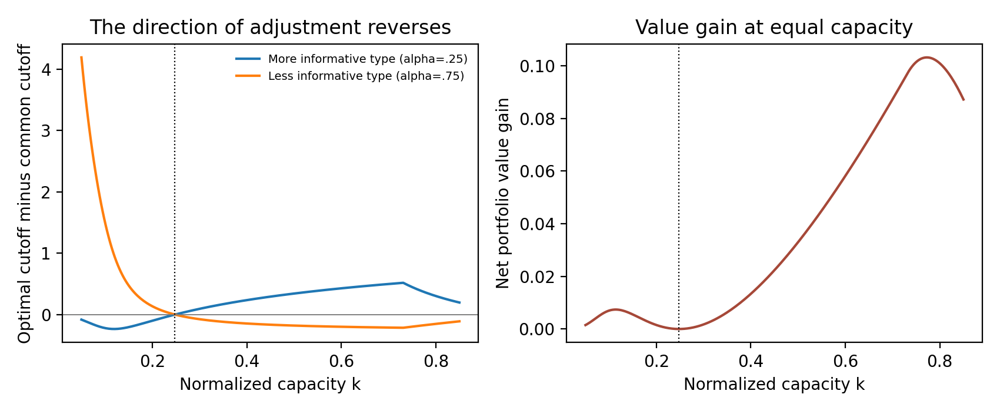

# 1. Introduction

Evidence requirements do more than rank a fixed list of proposals. Teams anticipate the approval rule before spending time on an application. A team that expects a low probability of passing may never submit. Since a funded team can receive career benefits even from an economically weak proposal, removing evidence requirements need not improve the portfolio. Conversely, applying the same statistical standard to activities with different measurement technologies can direct scarce resources toward the wrong margin.

This paper asks which direction an evidence adjustment should take once both channels are present. Should a difficult-to-measure activity face a weaker standard? There is no unconditional answer in our model. An adjustment that is optimal with a relatively generous budget is the wrong adjustment when the same organization has a sufficiently tight budget. Neither project value, intrinsic risk, applicant preferences, nor verification technology has to change for this reversal.

We solve a small screening model. Each potential team knows whether its project has a high or low continuation-adjusted value. The principal does not. Teams also know their own application cost. A common nonmonetary benefit of funding induces applications from both quality groups. The principal can commit to a verifiable score-based allocation but cannot buy truthful quality reports or fine unsuccessful teams. Score precision differs across public project classes. The principal maximizes organizational value net of the real labor costs spent on all applications, subject to a funding-capacity constraint.

The model yields three steps. First, endogenous application magnifies the ratio of good to bad award probabilities: conditional funding mass is proportional to the award probability raised to one plus the cost-distribution elasticity. Second, an optimal score-based rule is a deterministic upper-tail evidence gate. This follows from the likelihood-ratio ordering and the effect of low-quality awards on both resource use and application costs. Third, the resulting cross-class allocation has an explicit convex frontier. We solve its optimum and compare it with the best common cutoff, using exactly the same budget.

The main theorem concerns two classes with identical quality prevalence and payoff distributions and different score precision. A common cutoff is fully optimal at one interior budget, although precision is unequal. At every other interior budget, type-specific standards strictly improve value. More importantly, the direction of the improvement changes at that budget. With a generous budget, the common rule is too lenient for the more informative class and too demanding for the less informative class. With a tight budget, both comparisons reverse. Thus the apparently attractive policy of always compensating poor measurability with a weaker evidence requirement fails even in a setting without different intrinsic risk or implementation horizons.

This is not a new instance of the old negative-value-of-information result. The principal here uses evidence optimally within a stated mechanism class, and the rule has a derived screening benefit. Better verification under a fixed rationed policy can improve total value while discouraging good submissions in another class. Those withdrawals are an equilibrium spillover, not by themselves an inefficiency. The inefficiency we identify is the value gap between a common standard and optimal differentiated standards at the same capacity.

No firm data are available. The paper therefore reports completed theory and executable synthetic calculations. A separate short empirical appendix specifies the mechanism's distinguishable prediction and preserves the difference between a randomized whole-portfolio policy effect and the missing funded returns of rejected proposals.

# 2. Closest literature and scope of the contribution

The closest economic comparator is Adda and Ottaviani (2024). They analyze costly endogenous applications, noisy merit evaluation, and cross-field resource allocation; their fixed-budget and funding-rule design sections are directly relevant. Our narrower contribution is an explicit optimal common-cutoff boundary and its two-sided policy reversal with binary quality, independent cost heterogeneity, and power-shaped verification frontiers. We do not claim to originate endogenous application, noise-induced allocation effects, or the use of field-specific rules.

Carpenter and Ting (2007) already connect approval regulation, costly research, and endogenous submission. Henry and Ottaviani (2019) derive approval organizations when an informer controls costly sequential research. We instead hold the available verification experiment fixed and solve the principal's ex ante award rule and the teams' participation decisions. There is no strategic choice of experiment or sequential persuasion in the core model.

Bar and Gordon (2014) analyze selecting multiple privately informed projects using transfers under limited liability. Here transfers and penalties are unavailable; common funding benefits and application costs generate selection. Boleslavsky and Cotton (2018) study scarce capacity and competitive evidence production. Their agents choose information strategies, while ours choose whether to submit to a given verifiable experiment. These differences are assumptions defining the result, not claims that the wider mechanisms are unknown.

Koning, Hasan, and Chatterji (2022) study startup A/B testing, and Wu, Lou, and Hitt (2019) study analytics capabilities and decentralized innovation. Neither evidence technology is equivalent to a compulsory funding rule. Sharapov and Dahlander (2025) provides a close empirical precedent for tracking complete proposal pools as selection regimes change. Our model does not assume that experimentation is inherently incremental or that hard-to-measure projects are intrinsically superior.

LaValle (1986) and Nau (1987) establish important antecedents for negative information values under posterior chance constraints. That phenomenon was central to the earlier version of this paper and is not claimed as an original contribution here. The earlier Gaussian example and unsolved dynamic recursion have been removed from the article's results. The present results concern an optimal screening policy with endogenous entry and a precisely stated comparative static.

The verified primary sources and their reading depth are recorded in the accompanying ledger. The final Adda-Ottaviani article, especially Sections III and VIII, was inspected. Some adjacent papers were accessible only through publisher abstracts or author working versions, identified in that ledger. We have not found the exact scarcity-reversal formula below in the inspected sources. This supports a narrowly scoped candidate contribution, not a universal priority claim or a presumption of journal suitability.

# 3. Environment and feasible approval mechanisms

## 3.1 Project value and private application costs

A unit mass of potential teams is partitioned into public classes $t=1,\ldots,T$, with weights $w_t>0$ summing to one. A team has private quality $Q\in\{G,L\}$, independently drawn with $\Pr(G)=\pi\in(0,1)$ in every class. Funding a good project yields expected net organizational value $g>0$; a low-quality project yields $-\ell<0$. These values include the implementation costs and continuation opportunities of the funded activity. Section 8 derives them from a finite pilot-and-abandonment problem.

The same conditional payoff distributions apply in all classes. In the deterministic conditional-payoff case, intrinsic ex ante variance is $\pi(1-\pi)(g+\ell)^2$ in every class. Adding a common independent mean-zero cash-flow shock does not alter the results for a risk-neutral principal. Verification quality therefore differs without changing intrinsic project risk or expected project value.

The team receives a private nonmonetary benefit $R\in(0,1]$ from funding, regardless of quality. It pays a real application cost $c$ if it submits, whether or not funding follows. Costs are independent of quality and class, with

$$F(c)=c^{\eta},\qquad 0\leq c\leq1,\qquad \eta>0. \tag{1}$$

The principal cannot observe $c$ or $Q$. A team knows both before deciding whether to apply. Application costs represent labor or opportunity costs relevant to organizational value. The private benefit is not a cash transfer charged against the funding budget. If it is also counted in a broader welfare objective, it adds $R$ per funded project and is constant across full-capacity policies.

The principal has capacity $K$, measured as funded project starts. Each start has the same resource charge. Cash reservation can be written $B=bK$ for a common charge $b$; all comparisons use the same $K$ and $b$. Application costs are included in the objective rather than silently excluded from value. We take $0<K<R^{\eta}$ so the capacity is scarce relative to unrestricted applications and funding.

## 3.2 Verification technology

An applicant produces one verified score $Y\geq0$. The score is drawn only after the application cost is sunk. No pretesting, repeat submissions, selective suppression of scores, or manipulation is possible. Conditional on quality,

$$Y\mid G,t\sim\operatorname{Exp}(\alpha_t),\qquad
Y\mid L,t\sim\operatorname{Exp}(1),\qquad 0<\alpha_t<1. \tag{2}$$

The low-quality distribution is normalized across classes. Thus a common cutoff $e$ has the same low-quality pass probability $q=e^{-e}$ in every class. Good pass probability is $p_t=e^{-\alpha_t e}=q^{\alpha_t}$. A lower $\alpha_t$ raises power at every fixed false-positive probability and is our definition of more informative verification. It is not an assertion about the variance of an additive cash-flow error. The score likelihood ratio $\alpha_t\exp[(1-\alpha_t)y]$ increases strictly in $y$.

A common statistical evidence requirement therefore means equal cutoffs on this normalized score, equivalently equal false-positive probabilities before endogenous submission. It is not a common posterior-probability threshold. This distinction is necessary: the revised model derives an evidence gate but does not derive every rule an organization might call an evidence standard.

There is no differential feedback delay in the core allocation model. Cash-flow timing and the continuation option are identical across classes. A delay that worsens a real measurement technology can affect $\alpha_t$, but a delay that discounts cash returns changes $g$ and $\ell$ and must be modeled separately.

## 3.3 Commitment and information constraints

Before applications, the principal commits to an award function $\delta_t(y)\in[0,1]$ for each public class. The rule can be randomized and nonmonotone; deterministic gates are not assumed optimal in advance. It cannot depend on unverified quality or cost reports, use monetary transfers, or use an ex post penalty. Let

$$z_{tG}=E[\delta_t(Y)\mid G,t],\qquad
z_{tL}=E[\delta_t(Y)\mid L,t]. \tag{3}$$

A team's submission decision depends on these award probabilities. In a nonatomic population, each team's effect on aggregate capacity is zero. We use aggregate masses, with the standard exact-law-of-large-numbers interpretation for idiosyncratic draws. The policy must satisfy the resulting funding-capacity constraint. This is a continuum mechanism, not a finite-$N$ exact-budget theorem.

Commitment matters: the principal may not reset the rule after observing the applicant pool. A common-cutoff institution additionally requires the same cutoff and, if needed, the same anonymous rationing probability for all passing applicants. The differentiated optimum is solved over all award functions in (3), not merely over that restricted common-rule institution. Costly transfers, new experiment design, and correlation with applicant costs are outside the feasible class.

# 4. Equilibrium entry and the derived screening benefit

Write

$$\nu=\eta+1,\qquad \kappa=\frac{\eta}{\eta+1}R. \tag{4}$$

**Proposition 1 (entry and resource-cost accounting).** Given award probabilities $z_{tq}$, a quality-$q$ team submits if and only if $c\leq Rz_{tq}$. Equilibrium application mass and funded mass in that class-quality cell are, respectively,

$$A_{tq}=w_t\pi_q R^{\eta}z_{tq}^{\eta},\qquad
N_{tq}=w_t\pi_q R^{\eta}z_{tq}^{\nu}, \tag{5}$$

where $\pi_G=\pi$ and $\pi_L=1-\pi$. Total real application cost is $\kappa N$, where $N=\sum_{t,q}N_{tq}$ is total funding. Consequently,

$$W=\sum_t[gN_{tG}-\ell N_{tL}]-\kappa N. \tag{6}$$

The benefit from screening is derived from the quality composition in (5), while all real application costs are charged. At equal full funding, total application cost is constant, although application counts and individual costs need not be. This invariance is a consequence of (1) and the common private benefit, not a general claim about proposal writing.

For a gate with good and bad pass probabilities $(p_t,q_t)$ and a common funding lottery $a$ among passers, $z_{tG}=ap_t$ and $z_{tL}=aq_t$. Let

$$D(e)=\sum_t w_t[\pi p_t^{\nu}+(1-\pi)q_t^{\nu}].$$

The unique equilibrium rationing probability is

$$a=\min\left\{1,\left[\frac{K}{R^{\eta}D(e)}\right]^{1/\nu}\right\}. \tag{7}$$

If capacity binds, $N=K$. Posterior good-to-low odds among funded projects in class $t$ are

$$\frac{N_{tG}}{N_{tL}}=\frac{\pi}{1-\pi}
\left(\frac{p_t}{q_t}\right)^{\nu}. \tag{8}$$

Endogenous application contributes exponent $\eta$ in addition to the direct selection exponent one. Low-quality teams are less likely to incur the cost of submitting, but some still submit at every finite positive threshold. A gate is not assumed to identify all good projects or deter every weak application.

Under no evidence, $p_t=q_t=1$ and the common lottery funds good projects with share $\pi$. A positive common gate has $p_t>q_t$ in every class, so its full-capacity good share $\chi$ exceeds $\pi$. Its value gain over no evidence is exactly

$$W_{\mathrm{gate}}-W_{\mathrm{lottery}}
=K(g+\ell)(\chi-\pi)>0. \tag{9}$$

No arbitrary governance benefit is added. The right side is the payoff improvement from fewer low-quality funded starts, holding funding and total real application cost fixed. Misaligned private funding benefits are the reason cheap reports alone do not supply the missing information.

# 5. Optimal evidence gates and differentiated standards

## 5.1 Gates arise from the mechanism problem

Define $\beta_t=1/\alpha_t>1$. The following transparent sufficient condition will ensure full use of capacity:

$$\pi(g-\kappa)>(1-\pi)(\ell+\kappa)\max_t\beta_t. \tag{A1}$$

It is maintained for the global optimality and common-rule comparisons below. It is stronger than necessary and ensures that the marginal organizational value remains positive even at the least favorable point of each verification frontier. If it fails, the principal may optimally leave capacity unused; the main reversal theorem is not claimed for that region.

**Proposition 2 (optimal verification frontier).** For every score-based rule in (3),

$$z_{tL}\geq z_{tG}^{1/\alpha_t}. \tag{10}$$

For each $z_{tG}\in[0,1]$, equality is attained by an upper-tail gate $Y\geq e_t$. Replacing a rule above this frontier by the corresponding gate preserves good awards, reduces low awards, saves real application costs, and releases capacity. Thus an optimal mechanism can be implemented by deterministic gates. Under (A1), it fully uses capacity.

This result derives the gate from the team's incentives and a verified statistical experiment. It is a likelihood-ratio screening result, not a new theorem about optimal hypothesis testing. Its role is to connect the statistical frontier to the endogenous application problem. Arbitrary score randomization, including an anonymous lottery after certification, does not improve the differentiated optimum.

## 5.2 Scalar solution for all public classes

Set

$$x_t=p_t^{\nu}=e^{-\nu\alpha_t e_t},\quad
G(x)=\sum_t w_t\pi x_t,\quad
L(x)=\sum_t w_t(1-\pi)x_t^{\beta_t},\quad D=G+L. \tag{11}$$

Normalized capacity is $k=K/R^{\eta}\in(0,1)$. On the verification frontier, funded good and low masses are $R^{\eta}G$ and $R^{\eta}L$. At full capacity, $D=k$ and

$$W=R^{\eta}[(g+\ell)G-\ell k]-\kappa K. \tag{12}$$

Therefore the entire differentiated-policy problem is

$$\max_{0\leq x_t\leq1}G(x)
\quad\text{subject to}\quad D(x)\leq k. \tag{13}$$

**Theorem 1 (unique optimal allocation).** Under (A1), (13) has a unique solution, and its constraint binds. There is a unique $\rho>0$, up to the irrelevant all-saturated endpoint excluded by $k<1$, satisfying

$$x_t^*(\rho)=\min\left\{1,
\left[\frac{\rho\pi}{(1-\pi)\beta_t}\right]^{1/(\beta_t-1)}\right\},
\qquad D(x^*(\rho))=k. \tag{14}$$

The optimal gate is $e_t^*=-\log x_t^*/(\nu\alpha_t)$. Every class receives a strictly positive good funded mass at $k>0$, although that mass can be arbitrarily small. Capping at $x_t=1$ allows a class to face no evidence hurdle when capacity is sufficiently generous.

At interior coordinates, the common value of

$$m_t(x_t)=\frac{1-\pi}{\pi}\beta_t x_t^{\beta_t-1} \tag{15}$$

is $\rho$. This is the marginal low-quality funded mass per extra good funded mass. A principal equalizes that marginal screening cost across classes, rather than equalizing a statistical false-positive probability or a posterior probability of profit.

# 6. The policy theorem: scarcity reverses the direction of adjustment

## 6.1 Best common statistical standard

Under a common cutoff $e$, the normalized funding mass without rationing is

$$D_c(e)=\pi\sum_t w_t e^{-\nu\alpha_t e}
+(1-\pi)e^{-\nu e}. \tag{16}$$

It decreases continuously from one to zero. There is a unique $e_c(k)>0$ satisfying $D_c(e_c)=k$.

**Lemma 1 (optimality within common rules).** Under (A1), the best common-cutoff, common-lottery policy uses $e=e_c(k)$ and $a=1$. Relative to any laxer common cutoff that requires rationing, tightening raises the good funded share at the same $K$ and the same total application cost. Relative to any stricter common cutoff that underfills capacity, loosening raises net value.

The common rule is thus optimized within its institutional restriction. The comparison below does not choose a deliberately weak common-policy benchmark.

## 6.2 Exact crossing and global direction

Consider two classes, $\alpha_1<\alpha_2$, so class 1 has more informative verification. Let $w_1=w$ and $w_2=1-w$, with $w\in(0,1)$. Define

$$e_\times=\frac{\log(\alpha_2/\alpha_1)}{\nu(\alpha_2-\alpha_1)},
\qquad k_\times=D_c(e_\times),\qquad K_\times=R^{\eta}k_\times. \tag{17}$$

**Theorem 2 (scarcity reversal of optimal evidence adjustment).** Under (A1):

1.  At $k=k_\times$, the best common cutoff is also optimal among all feasible differentiated score-based mechanisms, despite $\alpha_1\ne\alpha_2$.

2.  If $k>k_\times$, differentiated standards strictly improve value and satisfy

$$e_1^*>e_c(k)>e_2^*.$$

The common rule is too lenient for the more informative class and too strict for the less informative class. 3. If $k<k_\times$, differentiated standards strictly improve value and satisfy

$$e_1^*<e_c(k)<e_2^*.$$

The common rule is too strict for the more informative class and too lenient for the less informative class.

All comparisons use the same full funding capacity $K$. The value gain is

$$W^*-W_c=R^{\eta}(g+\ell)[G(x^*)-G(x^c)]>0 \tag{18}$$

away from the crossing. It is not driven by different total application costs or idle budget.

The theorem gives an exact answer to when a common evidence standard can be second-best optimal. Symmetric technologies also make a common standard optimal by symmetry and uniqueness. With unequal technologies, the crossing is the unique interior budget with that property. Outside it, the common rule is optimal only within the common-rule restriction.

The economic reason is marginal rather than average screening quality. At a common cutoff,

$$\log\frac{m_1}{m_2}=
\log\frac{\alpha_2}{\alpha_1}-\nu(\alpha_2-\alpha_1)e_c. \tag{19}$$

This expression changes sign exactly once. With generous capacity, additional good awards from the less informative class have the lower marginal low-award cost, even though that class has lower average verification power. With tight capacity, the remaining high-score good projects in the more informative class offer the better margin. A blanket waiver for poorly measurable activities ignores this distinction.

This is a precisely delimited policy theorem for the exponential verification family and the application-cost distribution (1). It is not a distribution-free ranking of all innovation policies. Section 9 states what fails when those assumptions are relaxed.

**Corollary 1 (entry elasticity and the crossing).** Fix $\alpha_1,\alpha_2,\pi,w$. The normalized crossing $k_\times$ is independent of $\eta$. Optimal $x^*(k)$ is also independent of $\eta$. However, the cutoff $e_\times$ scales as $1/(\eta+1)$, and the raw capacity crossing is $K_\times=R^{\eta}k_\times$. Entry conditions can therefore change which side of the policy reversal a fixed raw budget occupies, without changing verification technology or project values.

# 7. Improved measurability: entry and portfolio spillovers

Better verification does not automatically encourage applications everywhere. Consider fixed cutoffs and a binding common lottery, so $a<1$. Improve only class 1 by increasing its good pass probability $p_1$, holding its low pass probability $q_1$ fixed. This is the power improvement generated by reducing $\alpha_1$ at a fixed $e_1>0$. Let

$$s=\frac{w_1\pi p_1^{\nu}}{D}\in(0,1).$$

**Proposition 3 (precision crowding under an unchanged rule).** The local elasticities with respect to $p_1$ are:

  Outcome            Class 1 good   Every unchanged class-quality cell
  --------------- --------------- ------------------------------------
  Applications      $\eta(1-s)>0$                          $-\eta s<0$
  Funded starts      $\nu(1-s)>0$                           $-\nu s<0$

Class 1 low-quality applications and funding also fall, because its low pass probability is unchanged while rationing becomes tighter. Total good funded share rises, total low funded share falls, and organizational value increases by $K(g+\ell)$ times the good-share change. Thus a more informative test can crowd out good applications from a different class without lowering aggregate value.

This result is a comparative static of an unchanged rationed institution, not a claim about the reoptimized policy in Theorem 1. If the principal resets every cutoff, the cross-class effects require the new optimum (14). The empirical prediction must specify whether rules adjust. Withdrawal alone does not diagnose the measurability trap; the common-policy value gap in (18) does.

## 7.1 Funding benefits, quality, and net value

The model also distinguishes improved winner quality from organizational value after applications are charged. Let $G^*(k)$ be the optimal good-mass function in (13) and let $\lambda(k)=1/(1+\rho(k))$ be its marginal value, including at class saturation points by continuity. Hold raw capacity $K$, technology, and project payoffs fixed while varying the common private funding benefit $R$.

**Proposition 4 (better winners can accompany lower net value).** At an interior $R$ satisfying (A1), the funded good share rises strictly with $R$. Nevertheless,

$$\frac{dW^*}{dR}=\eta R^{\eta-1}(g+\ell)
\left[G^*(k)-k\lambda(k)\right]-\frac{\eta}{\eta+1}K,
\qquad k=K/R^\eta. \tag{21}$$

For every fixed admissible $R>0$, this derivative is strictly negative for sufficiently small $K$. Its limit divided by $K$ is $-\eta/(\eta+1)$. Stronger career or control benefits then improve the funded quality distribution but lower organizational value.

The negative term is a derived real application-cost effect, not a penalty assigned to uncertainty. The quality gain becomes arbitrarily small once the tight budget already finances almost entirely good projects, while the extra application effort remains first order in $K$. This is a comparative static of private nonmonetary funding benefits. If those benefits are included as social utility, total welfare adds $RK$ and the derivative changes; the negative organizational-value conclusion is not a statement about that broader objective.

# 8. A solved continuation and abandonment benchmark

The static values can be generated by the following finite funding problem. Starting a pilot costs $c_0>0$ at date zero and reserves capacity for one project. At a common date $T$, the pilot perfectly reveals $Q$. Completing the project then requires $J>0$. Final gross cash payoff is $V_G$ for a good project and $V_L$ for a low project; abandonment yields zero. Let $d\in(0,1]$ be the common discount factor from $T$ to date zero, with $V_G>J>V_L$. Cash-flow uncertainty common across classes can be added after completion without changing risk-neutral continuation values.

Backward induction gives continuation for $G$ and abandonment for $L$. The conditional pilot-start values are

$$g=-c_0+d(V_G-J)>0,\qquad -\ell=-c_0,\quad\ell=c_0. \tag{20}$$

Funding without the abandonment option would instead yield $-c_0+d(V_q-J)$ in quality state $q$. The abandonment option therefore raises the low-quality value by $d(J-V_L)>0$. It is fully included in (20); the low project can still destroy the pilot cost even under optimal abandonment.

Both evidence policies fund exactly $K$ starts and reserve the same maximum cash budget $(c_0+J)K$. Realized completion spending can differ because the policies fund different quality mixes. Those different cash costs are already included in (20), rather than assumed equal. Unused reservations become available only after the cohort's start window closes; their common outside return is normalized to zero. Allowing valuable within-cohort redeployment would change the model and is not claimed to be solved.

For the synthetic primitives, take $c_0=J=1$, $d=.9$, $V_G=1+11/.9$ and $V_L=0$. Then $g=10$ and $\ell=1$. Theorems 1 and 2 apply unchanged. The difference between optimal differentiated and common evidence rules therefore survives a finite, completely solved continuation option and equal initial funding capacity. There is no unsolved Bellman equation or claim about optimal general exploration budgets in this article.

# 9. Numerical verification and synthetic illustration

## 9.1 Exact crossing and policy comparison

Use $\pi=w=.5$, $R=.5$, $\eta=1$, $g=10$, $\ell=1$, and $(\alpha_1,\alpha_2)=(.25,.75)$. These primitives satisfy (A1). Equation (17) gives

$$e_\times=\log3=1.0986123,\quad k_\times=.24800565,
\quad K_\times=.12400282.$$

The following are computed values in a hypothetical unit-mass economy, not empirical estimates. Every policy in a row block funds exactly $K=.5k$ starts.

  $k$     Policy                      $e_1$    $e_2$   Good funded share   Net value
  ------- ------------------------ -------- -------- ------------------- -----------
  .0500   No evidence                 .0000    .0000               .5000     .106250
  .0500   Best common                3.3166   3.3166               .9868     .240131
  .0500   Optimal differentiated     3.2346   7.5065               .9922     .241618
  .2480   No evidence                 .0000    .0000               .5000     .527012
  .2480   Best common                1.0986   1.0986               .7760     .903472
  .2480   Optimal differentiated     1.0986   1.0986               .7760     .903472
  .6000   No evidence                 .0000    .0000               .5000    1.275000
  .6000   Best common                 .3574    .3574               .5922    1.579421
  .6000   Optimal differentiated      .7852    .1585               .6099    1.637591

At $k=.6$, relaxing the less informative class while tightening the more informative class improves value by .058170. At $k=.05$, the improving adjustment goes in the opposite direction. Application costs are respectively .075 and .00625 under every full-capacity policy at these two budgets. More favorable allocation is not financed by omitting application costs.

## 9.2 Independent checks

The main implementation solves (14) by a scalar root. A separate implementation parameterizes the full budget frontier by $x_1$, recovers $x_2$ from the resource equation, and optimizes a scalar objective with explicit boundary comparisons. Across 30 predetermined synthetic verification cases, the maximum discrepancy in $G$ is below $2.6\times10^{-14}$. These cases verify an analytical algorithm; they are not an evidentiary substitute for the theorem.

A third calculation optimizes the original cutoff pair over rationed, exactly filled, and underfilled regimes using differential evolution, rather than using the optimality conditions. At normalized budgets .05, .2, and .6, its value differs from the analytical solution by at most $1.3\times10^{-11}$. Numerical global search is not a proof of global optimality; that proof is in Appendix A.

For the funding-benefit comparative static, at $K=.005$ and $R=.5$, the reoptimized value derivative is approximately $-.002479$ while good funded share increases with $R$. At $K=.1$, the value derivative is positive, approximately $.420670$. These are synthetic evaluations of equation (21), not estimated behavioral responses.

Additional checks integrate the cost distribution directly, test the verification-frontier inequality for 200 nonmonotone randomized score rules, verify the precision spillover signs, and recover the pilot values by backward induction. The crossing's invariance to entry elasticity is checked separately for three elasticities. Outputs, exact parameter values, software versions, and an execution log are supplied. No Monte Carlo standard errors are represented as empirical confidence intervals.

Python is the executed runtime. A separate base-R script reproduces the main scalar solutions but is unexecuted in this environment because R was unavailable. The editable manuscript is supplied in Markdown and LaTeX. No real organizational dataset is used.

## 9.3 Robustness and limits

The reversal is global within the maintained model, but not model-free. A different ROC family can move, multiply, or remove crossings of marginal screening costs. Equation (15), rather than (17), is the relevant general principle. Quality-dependent private benefits or costs can change the entry exponent and the constant-cost identity. Correlation of quality with application cost can make an evidence adjustment valuable through a different channel. If (A1) fails, unused capacity can be optimal and the common-rule comparison needs a new case analysis.

The theorem excludes score manipulation, endogenous experiment choice, monetary transfers, and a principal unable to commit. A finite organization may face aggregate uncertainty and an exact ex post budget that our continuum approximation does not represent. Exponential scores give a convenient power ROC; their particular tail shape drives the explicit crossing. The paper provides a solved comparative-static result in that environment, not a calibrated measure of how much real innovation is lost.

# 10. Conclusion {#empirical-implication-and-conclusion}

A distinctive test is an interaction between baseline verification informativeness and ex ante capacity scarcity in the value of relaxing a common evidence rule. The prediction is not simply that poorly measurable proposals receive less funding. It is that the direction of an improving type-specific adjustment changes across a measurable capacity boundary, conditional on project value distributions, private funding benefits, and application-cost conditions. The separate empirical protocol describes a prospective test and its substantial data requirements.

The primary policy outcome is the value of the entire activity portfolio induced by a rule, including applications, withdrawals, implementation, abandonment, and follow-on costs. A randomized comparison with complete domain-level value accounting can identify that policy effect without observing every rejected proposal's funded return. Missing rejected funded returns instead obstruct project-level error losses, oracle rankings, and some mechanism decompositions. Public award records alone do not identify the proposed intervention or value effect.

The theoretical answer is conditional but substantive. Evidence gates can be optimal because they deter privately attractive low-value submissions. Common standards can be optimal despite unequal precision, but only at a specific scarcity level in the solved two-class environment. On either side, differentiated standards improve the portfolio at exactly the same funding capacity, and the optimal direction of adjustment reverses. This is the completed result of the revision. Its limitations are the restricted information and contracting environment, parametric verification technology, and the absence of firm-level evidence. The strongest remaining rejection concern is whether this sharply specified theorem adds enough economic content beyond the extensive existing theory of endogenous applications and statistical screening.

# References {#references .unnumbered}

Adda, Jérôme, and Marco Ottaviani. 2024. Grantmaking, Grading on a Curve, and the Paradox of Relative Evaluation in Nonmarkets. *Quarterly Journal of Economics* 139(2): 1255-1319. <https://doi.org/10.1093/qje/qjad046>. Published online 18 September 2023.

Bar, Talia, and Sidartha Gordon. 2014. Optimal Project Selection Mechanisms. *American Economic Journal: Microeconomics* 6(3): 227-255. <https://doi.org/10.1257/mic.6.3.227>.

Boleslavsky, Raphael, and Christopher Cotton. 2018. Limited Capacity in Project Selection: Competition through Evidence Production. *Economic Theory* 65(2): 385-421. <https://doi.org/10.1007/s00199-016-1021-0>. Author manuscript inspected separately from the final publication record.

Carpenter, Daniel, and Michael M. Ting. 2007. Regulatory Errors with Endogenous Agendas. *American Journal of Political Science* 51(4): 835-852. <https://doi.org/10.1111/j.1540-5907.2007.00284.x>.

Henry, Emeric, and Marco Ottaviani. 2019. Research and the Approval Process: The Organization of Persuasion. *American Economic Review* 109(3): 911-955. <https://doi.org/10.1257/aer.20171919>.

Koning, Rembrand, Sharique Hasan, and Aaron Chatterji. 2022. Experimentation and Start-up Performance: Evidence from A/B Testing. *Management Science* 68(9): 6434-6453. <https://doi.org/10.1287/mnsc.2021.4209>.

LaValle, Irving H. 1986. On Information-Augmented Chance-Constrained Programs. *Operations Research Letters* 4(5): 225-230. <https://doi.org/10.1016/0167-6377(86)90006-4>.

Nau, Robert F. 1987. Note: Blau's Dilemma Revisited. *Management Science* 33(10): 1232-1237. <https://doi.org/10.1287/mnsc.33.10.1232>.

Sharapov, Dmitry, and Linus Dahlander. 2025. Selection Regimes and Selection Errors. *Organization Science* 36(6): 2324-2348. <https://doi.org/10.1287/orsc.2023.17482>.

Wu, Lynn, Bowen Lou, and Lorin Hitt. 2019. Data Analytics Supports Decentralized Innovation. *Management Science* 65(10): 4863-4877. <https://doi.org/10.1287/mnsc.2019.3344>.

# Appendix A. Complete proofs

## A.1 Proposition 1

A team awarded with probability $z$ obtains expected utility $Rz-c$ from applying and zero otherwise. Since $R\leq1$ and $z\leq1$, the cost cutoff lies in the support of (1). Except at a zero-mass indifference point, the strategy is uniquely $1\{c\leq Rz\}$. The applicant fraction is $(Rz)^\eta$, and multiplying by the award probability gives $R^\eta z^{\eta+1}$. Multiplying by the class-quality mass proves (5).

For one cell, real cost is

$$w_t\pi_q\int_0^{Rz} c\eta c^{\eta-1}dc
=w_t\pi_q\frac{\eta}{\eta+1}R^{\eta+1}z^{\eta+1}
=\kappa N_{tq}.$$

Summing proves (6). A common lottery multiplies all conditional pass probabilities by $a$, so total funding is $R^\eta a^\nu D$. It is continuous and strictly increasing in $a$ unless $D=0$. If $R^\eta D\leq K$, $a=1$; otherwise its unique capacity-clearing value is (7). This proves equilibrium uniqueness for that rationing institution, including the effect of participation on the mass of passers. Taking the ratio of the two funded masses proves (8). At full capacity, (6) is $K[(g+\ell)\chi-\ell-\kappa]$; subtract the no-evidence value with $\chi=\pi$ to obtain (9). Because $p_t>q_t$ for $e>0$ and $\alpha_t<1$, $\chi>\pi$.

## A.2 Proposition 2: statistical frontier and global mechanism reduction

Fix a class and a rule $\delta$. Let $u=z_G\in(0,1)$ and choose $e$ with $e^{-\alpha e}=u$. Define the threshold rule $\delta_e(y)=1\{y\geq e\}$. Set $r_e=f_G(e)/f_L(e)>0$. Strictly increasing likelihood ratio implies that $f_G(y)-r_e f_L(y)$ is negative below $e$ and positive above $e$. Since $\delta-\delta_e\geq0$ below $e$ and $\delta-\delta_e\leq0$ above $e$,

$$\int(\delta-\delta_e)(f_G-r_e f_L)dy\leq0.$$

The good-probability difference is zero by construction. Therefore $-r_e(z_L-e^{-e})\leq0$, proving $z_L\geq e^{-e}=u^{1/\alpha}$. The endpoints follow by continuity. Strict likelihood-ratio ordering makes equality unique up to null sets for $0<u<1$.

By Proposition 1, holding $z_G$ fixed preserves good funding and its application costs. Reducing $z_L$ lowers low funding and saves $\ell+\kappa>0$ per such funded start in (6). It never violates an upper capacity constraint. Hence every feasible rule is weakly dominated by its upper-tail counterpart, with a strict improvement if (10) is strict and low applications have positive mass. The principal's optimization can be restricted to gates without assuming them.

For gates write $x_t=z_{tG}^\nu$, so $z_{tL}^\nu=x_t^{\beta_t}$. Net value is

$$R^\eta\sum_t w_t[\pi(g-\kappa)x_t-(1-\pi)(\ell+\kappa)x_t^{\beta_t}].$$

Its derivative with respect to $x_t$ is

$$R^\eta w_t[\pi(g-\kappa)-(1-\pi)(\ell+\kappa)\beta_t x_t^{\beta_t-1}]>0$$

under (A1). If funding is below $K$, at least one $x_t<1$, because $K<R^\eta$; increase that coordinate slightly. The capacity remains feasible for a sufficiently small increase and value rises. Thus every optimum funds exactly $K$. Equation (12) now makes maximizing $G$ equivalent to maximizing value. This proves the mechanism reduction and (13).

Unverified cheap reports cannot improve this frontier. In any menu of score rules, a given quality chooses the rule with the largest conditional award probability, independently of its application cost. Let the rule chosen by good teams generate good probability $u$. Low teams can choose that same rule; their actual maximum probability is therefore at least its low probability, itself at least $u^{1/\alpha}$. The same bound (10) holds for the resulting pair. The gate achieves the bound without reports. This argument requires the common award benefit and the absence of report-dependent payments or costs specified in the model.

## A.3 Theorem 1

The feasible set of (13) is compact and nonempty, so a solution exists. $D$ is continuous, strictly increasing coordinatewise, and strictly convex because every $\beta_t>1$ and every weight is positive. A maximizer uses $D=k$: otherwise an unsaturated coordinate could increase $G$. All coordinates are positive. To see this, if $x_i=0$ and another coordinate $x_j>0$, the marginal low-to-good cost is zero at $i$ but positive at $j$. Moving a sufficiently small amount of good funded mass from $j$ to $i$ strictly reduces $D$, then the released capacity permits an increase in $G$, contradicting optimality.

Uniqueness follows from strict convexity. If two distinct maximizers existed, their midpoint would have the same $G$ but strictly smaller $D$. It would therefore admit a strict increase in $G$, a contradiction.

The convex constraint has a strictly feasible point, so its multiplier characterization is sufficient as well as necessary. At an interior coordinate, the first-order condition is

$$w_t\pi=\lambda w_t[\pi+(1-\pi)\beta_t x_t^{\beta_t-1}].$$

Thus $\rho=1/\lambda-1>0$ equals (15) and solving gives (14). If that expression exceeds one, the upper-bound complementary-slackness condition sets $x_t=1$. Conversely, the formula with these caps satisfies every first-order and complementary-slackness condition. The mapping $\rho\mapsto D(x^*(\rho))$ is continuous, starts at zero, and increases strictly until all coordinates saturate. Since $k\in(0,1)$, a unique relevant root exists. This completes the global solution.

## A.4 Lemma 1

For common $e$, $D_c$ is continuous and strictly decreasing from one to zero, proving existence and uniqueness of $e_c$. If $e<e_c$, capacity binds through $a<1$. Let $G_c=\pi\sum_tw_te^{-\nu\alpha_t e}$ and $L_c=(1-\pi)e^{-\nu e}$. Then

$$\frac{d}{de}\log(L_c/G_c)
=-\nu+\nu\frac{\sum_t w_t\alpha_t e^{-\nu\alpha_t e}}
{\sum_t w_t e^{-\nu\alpha_t e}}<0.$$

Thus tightening raises $G_c/(G_c+L_c)$, and full-capacity value rises because application cost is $\kappa K$. If $e>e_c$, no rationing occurs and capacity is underused. Reducing $e$ increases each $x_t$. The strict positive derivative established under (A1) raises value until $e=e_c$. Therefore the best common policy is exactly the stated one.

## A.5 Theorem 2

At the common allocation $x_t^c=\exp(-\nu\alpha_t e_c)$, substitute into (15):

$$m_t(x_t^c)=\frac{1-\pi}{\pi\alpha_t}
\exp[-\nu(1-\alpha_t)e_c].$$

Taking the log ratio yields (19), whose unique zero is $e_\times$ in (17). Both coordinates of a positive common cutoff are interior. By Theorem 1, the common allocation is globally optimal exactly when their marginal screening costs agree. Hence this occurs exactly at $e_c=e_\times$, or equivalently $k=k_\times$.

For the direction, parameterize the two-class binding budget curve by $x_1$, with $x_2(x_1)$ the unique decreasing solution to $D=k$ wherever feasible. Differentiation gives

$$\frac{dx_2}{dx_1}=-\frac{w\pi(1+m_1)}{(1-w)\pi(1+m_2)},\qquad
\frac{dG}{dx_1}=\frac{w\pi(m_2-m_1)}{1+m_2}. \tag{A2}$$

As $x_1$ rises along this curve, $m_1$ strictly rises and $m_2$ strictly falls. The derivative can therefore cross zero at most once, from positive to negative; if it never crosses, the maximizer is the corresponding feasible endpoint. If $k>k_\times$, monotonicity of $D_c$ gives $e_c<e_\times$, and (19) gives $m_1>m_2$. At the common point, (A2) is negative. Its global maximum is strictly to the left: $x_1^*<x_1^c$ and $x_2^*>x_2^c$. Because each cutoff decreases strictly in its own $x$, $e_1^*>e_c>e_2^*$. The case $k<k_\times$ reverses all inequalities. Strict uniqueness in Theorem 1 yields a strict value gain at every noncrossing capacity. Equation (18) follows directly from (12). The proof includes capped optima because the sign argument places the maximizer on the correct side even when an endpoint is reached.

## A.6 Corollary 1

In (17), $\nu e_\times=\log(\alpha_2/\alpha_1)/(\alpha_2-\alpha_1)$ does not depend on $\eta$. Substituting this product into (16) proves the invariance of $k_\times$. Neither (13) nor (14) depends on $\eta$ at a fixed $k$, so $x^*(k)$ is invariant. Recovering $e_t$ divides by $\nu\alpha_t$, while converting normalized to raw capacity multiplies by $R^\eta$. All statements follow.

## A.7 Proposition 3

Only $p_1$ changes in $D$. Therefore $d\log D/d\log p_1=\nu s$. From (7) in the binding region, $d\log a/d\log p_1=-s$. An unchanged cell has application mass proportional to $a^\eta$ and funded mass proportional to $a^\nu$, giving elasticities $-\eta s$ and $-\nu s$. For class 1 good teams, these masses are proportional to $(ap_1)^\eta$ and $(ap_1)^\nu$, giving the positive entries in the table. The low probabilities, including class 1's, do not change directly.

At fixed cutoffs, normalized low pre-rationing mass $L$ is constant, while $G$ rises. Full funding implies the low funded share is $L/(G+L)$, which falls strictly. Good funded share therefore rises. Total application cost remains $\kappa K$ and (6) proves the value claim. The calculation is local to a region with $a<1$; a finite improvement remains covered only while both endpoints and the path stay in that region.

## A.8 Section 8: continuation and equal capacity

At date $T$, quality is revealed and the only two actions are abandon for zero or complete for $V_q-J$. Their maximum is the unique optimal continuation value except at a zero-profit tie, excluded by $V_G>J>V_L$. Discounting and subtracting the initial pilot cost gives (20). The maximum cash requirement for $K$ starts is $(c_0+J)K$, independent of the gate. Starting a low-quality pilot loses $c_0$ even though no completion expenditure is wasted. Replacing the abstract values by (20) leaves every entry, likelihood-ratio, budget, and allocation argument unchanged. This is a solved finite embedding, not a general theorem about recycling abandoned project capacity.

## A.9 Proposition 4

The optimal value function $G^*(k)$ in (13) is concave: convex combinations of feasible allocations at two budgets are feasible at the same convex combination of budgets because $D$ is convex, and $G$ is linear. Its multiplier is $\lambda(k)=1/(1+\rho(k))$. Equation (14) makes $\rho$ continuous and strictly increasing over $k\in(0,1)$, so $\lambda$ is continuous and strictly decreasing. Thus $G^*$ is differentiable, strictly concave, and $G^*(0)=0$. In particular, $G^*(k)-k\lambda(k)>0$ at $k>0$. The good funded share is $G^*(k)/k$, strictly decreasing in $k$; raising $R$ lowers $k$ and hence raises this share.

From (12),

$$W^*(R)=R^\eta(g+\ell)G^*(K/R^\eta)-\ell K-\frac{\eta}{\eta+1}RK.$$

Differentiation proves (21). As $k\downarrow0$, (14) gives $\rho\downarrow0$ and all $x_t\downarrow0$. Since every $\beta_t>1$, $L/G\to0$, so $G^*(k)/k\to1$; also $\lambda(k)\to1$. It follows that $[G^*(k)-k\lambda(k)]/k\to0$. Divide (21) by $K=R^\eta k$ at fixed $R$ to get the stated negative limit. (A1) holds in a neighborhood of a strict admissible $R$, validating the local derivative. This completes the proof.
